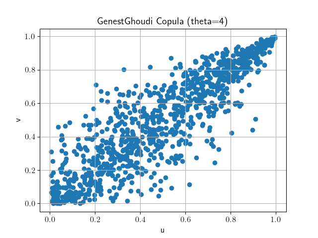
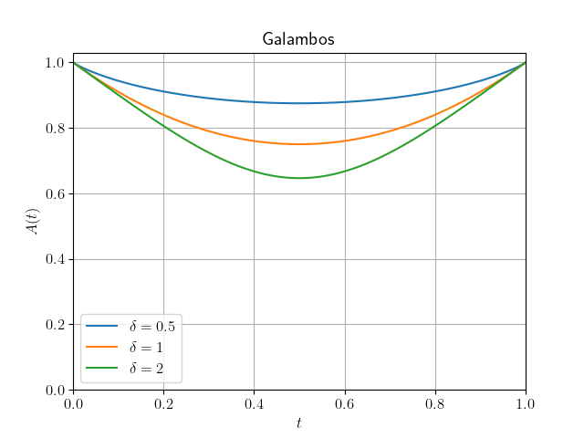

copul documentation
===================

**copul** is a Python toolkit for research on copulas and dependence measures.
It combines symbolic copula families (built on SymPy) with a uniform, vectorised
numerical API, a numerical engine for rank correlations and measures of
dependence such as Chatterjee's :math:`\xi`, exact formulas for checkerboard,
Bernstein and shuffle-of-min copulas, statistical estimation and fitting, and
research tools for exact regions between measures, optimisation over
checkerboard copulas and counterexample search.

Statement of need
-----------------

Mature copula software (for instance the R packages ``copula``, ``VineCopula``
and ``rvinecopulib``, or the Python packages ``copulae``, ``pyvinecopulib``,
``copulas`` and ``statsmodels``) is designed for estimation and simulation from
data. Theoretical research on copulas and dependence measures needs exact
expressions for families with free parameters, reliable values of measures for
which closed forms are rarely known, approximating copulas with exact formulas,
and quick ways to test conjectured inequalities or to find extremal copulas.
copul is written for this workflow. Its audience is researchers in probability,
statistics and quantitative finance who study dependence structures, and
teachers and students who want executable versions of the formulas in standard
references such as Nelsen (2006) and Joe (2014). copul originated in the work on
`Dependence properties of bivariate copula families
<https://doi.org/10.1515/demo-2024-0002>`_ (Ansari and Rockel, Dependence
Modeling, 2024) and implements the copula families studied there.

Installation
------------

.. code-block:: bash

   pip install copul              # core package
   pip install "copul[optim]"     # with cvxpy for copul.optim

copul requires Python 3.10 or newer.

Quickstart
----------

.. code-block:: python

   >>> import copul as cp
   >>> clayton = cp.Clayton(theta=2)
   >>> clayton.cdf(0.3, 0.7)            # numerical evaluation
   0.2868649025057026
   >>> cp.Clayton().cdf()               # symbolic, with free parameter
   Max(0, -1 + v**(-theta) + u**(-theta))**(-1/theta)
   >>> cp.Clayton().kendalls_tau()      # closed form
   theta/(theta + 2)
   >>> cp.FarlieGumbelMorgenstern().chatterjees_xi()
   theta**2/15
   >>> cp.compute_measures(clayton, ["xi", "rho", "tau"])
   {'xi': 0.3342917352885171, 'rho': 0.6822338332806566, 'tau': 0.5}
   >>> samples = clayton.rvs(10_000, random_state=0)   # exact, vectorised sampling

Copula families are listed in ``cp.families``, special copulas such as the
Fréchet bounds in ``cp.copulas`` and approximating copulas in
``cp.approximations``. When no closed form is known, a copula can be replaced
by an approximation with exact formulas:

.. code-block:: python

   >>> cp.Clayton(theta=2).to_checkerboard(10).chatterjees_xi()
   0.31577131817935733

Custom copulas are created from a cdf, density, generator, Pickands function or
mass matrix (``cp.from_cdf``, ``cp.from_pdf``, ``cp.from_generator``,
``cp.from_pickands``, ``cp.from_matrix``):

.. code-block:: python

   >>> family = cp.from_cdf("u*v + theta*(u**2 - u)*(v**2 - v)")
   >>> family(theta=0.5).validate_copula(return_details=False)
   True

.. raw:: html

     

Where to go next
----------------

- :doc:`overview`: implemented families, properties and methods.
- :doc:`measures`: dependence measures and the ``method=`` switch between closed
  forms, quadrature, SymPy and Monte Carlo.
- :doc:`custom_copulas` and :doc:`approximating_copulas`: user-defined copulas,
  checkerboard, Bernstein and shuffle-of-min copulas.
- :doc:`research_workflows`: exact regions, optimisation over checkerboard
  copulas and counterexample search.
- :doc:`copula_theory`: Sklar's theorem, Archimedean and extreme-value theory,
  dependence concepts, Markov operators, bounds and multivariate copulas.
- :doc:`community`: getting help, reporting bugs, contributing and citing copul.
- :doc:`modules`: the full API reference.

.. toctree::
   :maxdepth: 2
   :caption: Contents:

   overview
   measures
   custom_copulas
   approximating_copulas
   research_workflows
   copula_theory
   community
   modules

Indices and tables
==================

* :ref:`genindex`
* :ref:`modindex`
* :ref:`search`
